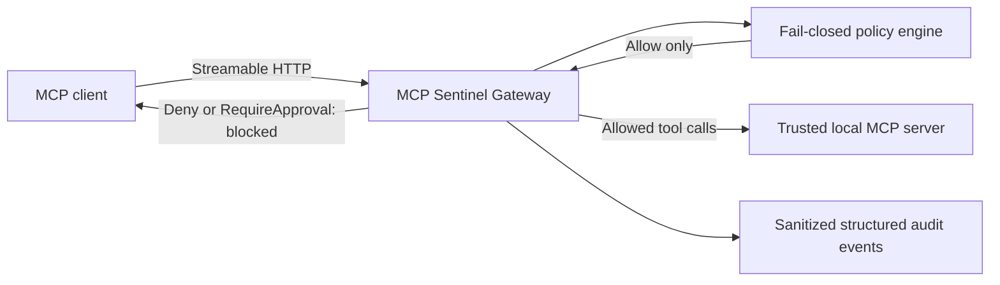

# MCP Sentinel

**Let agents discover tools. Decide what they may execute.**

MCP Sentinel is a small, open-source policy gateway for AI agents using the Model Context Protocol. An agent can discover a tool without having permission to run it. Sentinel checks each requested tool name before forwarding an allowed call and records a sanitized security audit trail.

Built with **.NET 10** and the official **ModelContextProtocol SDK 2.2.0**. This v0.1.0 demonstration uses one trusted local upstream and mock data. **It is not production-ready.**



## Why MCP Sentinel?

MCP makes it easy for AI agents to discover and interact with external tools. But discovering a capability should not automatically grant permission to execute it.

MCP Sentinel demonstrates a simple architectural approach:

- **Discover freely:** Allow agents to inspect available tools and schemas.
- **Enforce centrally:** Evaluate every tool invocation against explicit policies.
- **Deny by default:** Block unknown and unauthorized tools before upstream execution.
- **Observe decisions:** Capture sanitized audit events without exposing sensitive payloads.

The project is intended for developers exploring secure MCP integrations, agent infrastructure, and policy-enforced tool execution.

It is an experimental local reference implementation, not a production security product.

## What works today

- Real MCP initialization, tool discovery and forwarding through the official SDK.
- Immutable policies with exact, ordinal, case-sensitive tool-name matching.
- Deny by default; invalid configuration prevents startup.
- Distinct Allow, Deny and RequireApproval decisions; approval always blocks in this MVP.
- Protocol-aware tool result handling, cancellation and bounded upstream operations.
- Structured console audit events without tool arguments or response content.
- A console demo, isolated HTTP integration tests and Ubuntu GitHub Actions CI.

## Three tools, three decisions

[The demo policy](policies/demo-policy.json) is deliberately simple:

| Requested tool | Decision | Gateway behavior |
|---|---|---|
| `customer.read` | Allow | Forward to mock upstream |
| `customer.delete` | Deny | Block before forwarding |
| `invoice.refund` | RequireApproval | Block; no approval workflow exists |
| Any unconfigured name | Deny | Block |

Discovery includes all three tools and their schemas. Discovery is not authorization. JSON requires `defaultAction: "Deny"` and a `rules` array containing `toolName` and `action`. Missing/unknown fields, duplicate properties/rules, unsupported actions, blank names and malformed JSON are rejected.

## One-command demo

Install the .NET 10 SDK and PowerShell 7.2 or later, then run from the repository root:

```powershell
pwsh -File ./scripts/run-demo.ps1
```

The script builds Release, starts its own DemoServer and Gateway on available loopback ports, waits for host readiness signals, runs real MCP requests through the Gateway, verifies audit events and mock invocation counters, then shuts down only its own children. No keys, database or pre-existing server is needed. The first build needs access to NuGet packages.

Expected scenario output (the selected port varies; build output is omitted):

```text
Gateway: http://127.0.0.1:<port>/mcp
Connected to Gateway via MCP Streamable HTTP.
Discovered: customer.read, customer.delete, invoice.refund
customer.read   -> ALLOW            | upstream operation succeeded
customer.delete -> DENY             | blocked before upstream execution
invoice.refund  -> REQUIRE_APPROVAL | blocked; approval workflow unavailable
Upstream counters: customer.read=1; customer.delete=0; invoice.refund=0
Audit verified: 3 policy decisions, 3 terminal outcomes; no demo arguments or response content.
Demo passed (mock scenario counts, not an exactly-once guarantee).
Cleanup verified: 3 owned child processes exited.
```

The count of one is an assertion about this mock scenario, not a general execution guarantee. See [demo instructions and troubleshooting](docs/demo.md) for port selection, manual startup and failure checks.

## How enforcement works

1. Validate the loopback upstream URL, load policy, initialize the upstream MCP client and discover its tools **before opening the Gateway listener**.
2. Evaluate the exact name of every downstream tool invocation. Only explicit Allow for a discovered tool can enter the upstream SDK call.
3. Return Deny and RequireApproval as tool error results without upstream invocation.
4. Preserve upstream error status and compatible result data; record policy and terminal audit outcomes separately.

The 10-second connection/discovery startup budget begins **after policy loading**. Policy reading supports caller cancellation but has no separate timeout. Each forwarded SDK operation has a 10-second budget including continuation rounds.

Demo tool-result compatibility is tested for `2024-11-05`, `2025-03-26`, `2025-06-18`, `2025-11-25` and `2026-07-28`. A fresh result leaves `ResultType` for the downstream SDK to stamp: `complete` for July 2026, absent for older revisions. Structured content remains structured from June 2025 onward; the two older revisions receive its JSON as text. Arbitrary newer schemas/content types may need further adaptation.

**SDK continuation matters:** the application has no retry loop, but SDK 2.2.0 can reissue an allowed request after an `input_required` response carrying continuation state. No public SDK option disables that loop. Policy is evaluated once per downstream invocation; its unchanged tool name remains subject to the same immutable policy. Tests cover two upstream invocations for one continuation and 11 before retry exhaustion yields an error. Denied calls never enter that operation. No exactly-once guarantee is made.

## Security audit events

Each downstream handler invocation gets a generated correlation ID and attempts `PolicyEvaluated` (event 1000), then one terminal emission of `InvocationCompleted` (event 1001), including when decision logging fails. Structured fields include UTC timestamp, tool name, decision, enforcement outcome, upstream operation status, duration and an error category. Audit provider/resolution failures are isolated only within the audit boundary; they do not change policy decisions, tool results, execution exceptions or cancellation, and never trigger another execution. No recursive fallback logging is used.

Blocked calls report `NotAttempted`. A completed operation reports `Succeeded` or `ToolError`. A forwarded operation interrupted by cancellation, timeout or an exception reports `Unknown`: effects may already have occurred. Correlation IDs describe downstream operations, not physical upstream invocation counts. Arguments, credentials, response content and exception messages are excluded. Successful audit delivery is not guaranteed. Durable, mandatory or tamper-proof audit storage is not implemented.

## Tests and CI

```shell
dotnet restore
dotnet build --configuration Release
dotnet test --configuration Release
```

Tests use actual SDK clients and Kestrel on dynamic loopback ports. They cover policy validation, concurrent evaluation, blocked execution counters, upstream failures, serialized mixed-version results, continuation behavior, cancellation and audit payload exclusion. No external service or fixed startup sleep is required.

[CI configuration](.github/workflows/ci.yml) runs on push and pull requests using Ubuntu, .NET 10, Release builds, all tests and the public demo. It uses read-only repository permission and no secrets. The workflow must pass on GitHub before a release is approved; its presence is not proof of a green run.

## Security limitations

- No authentication or user-specific authorization. Any process reaching the endpoints can call them.
- Direct access to DemoServer bypasses Gateway enforcement. Loopback binding and Host filtering are development defaults, not access control; do not expose the demo publicly.
- One trusted upstream, with a catalog snapshotted at startup. Restart after policy/tool changes. Metadata and results are not sanitized for prompt injection.
- Tool-name policy does not validate arguments or protect resources/prompts. Sampling, elicitation, roots workflows, progress and task workflows are not relayed.
- No approval workflow, durable audit persistence, rate limiting or policy reload.
- Continuations may repeat invocations or side effects. Cancellation cannot roll back effects; an eventual error does not establish that nothing happened upstream.
- SDK diagnostic logging is disabled to avoid payload logging. Tool names are intentionally audited and should not contain secrets.

For the implementation boundaries, see [architecture](docs/architecture.md).

## Roadmap

- **v0.1.0:** policy engine, local MCP enforcement, protocol handling, structured audit logging, public demo and CI.
- **Future consideration:** authenticated deployment boundaries, durable audit sinks, approval design and explicit upstream identity mapping. These are not implemented or release promises.

## License and maintainer

Released under the [MIT license](LICENSE).

Maintained by Behnam Maghoul, Senior Software Engineer & AI Solution Architect.

I specialize in designing AI-powered systems, secure integrations, and scalable backend architectures.

For technical discussions, architecture consulting, or collaboration opportunities, connect with me on [LinkedIn](https://www.linkedin.com/in/behnam-m-24140453/).

For bug reports and feature requests, please use GitHub Issues. Do not include credentials or sensitive tool payloads in reports.

See [CHANGELOG](CHANGELOG.md) and the [v0.1.0 release notes draft](docs/release-notes-v0.1.0.md).
